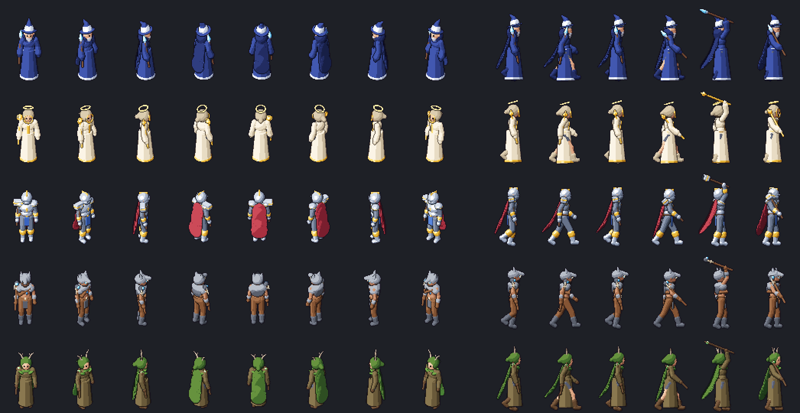
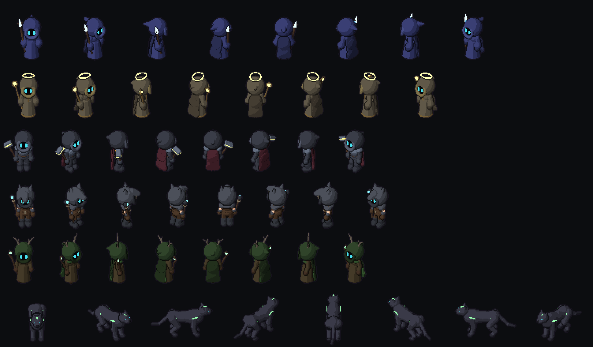

# PixelDSL

[](https://github.com/slowpoke-flex/PIXELDSLSTUDIO/actions/workflows/tests.yml)
[](./LICENSE)
[](https://creativecommons.org/publicdomain/zero/1.0/)

Reproducible pixel-art game assets from small JSON models. A model is built from
3D primitives (spheres, cones, boxes...) on a skeleton; PixelDSL ray-marches it with
an orthographic game camera and turns it into crisp, outlined, toon-shaded sprites:

- **views**: top-down 2.5D (8 directions), side view (platformers), isometric, front (icons/portraits)
- **shared bases**: human (`adult`, `chibi`) and four-legged (`feline`), each with idle, walk,
  run, attack, cast, jump, hurt, death - every character is a base plus clothing/props, so all of
  them animate and turn the same way
- **emissive layers**: `glow` materials (crystals, halos) and `team` materials (eyes, exported white
  for tinting with the team colour) are also written as separate sheets/sprites
- **props**: chests, barrels, crystals, trees, items (static, `bob`, `spin`)
- **seamless tiles**: grass, dirt, sand, stone, water (animated), side-view ground
- **export**: PNG sheets + JSON metadata, normal maps, GameMaker sprites, Godot `SpriteFrames`
- **prototyping**: HTML player (`preview`), live rebuild on save (`watch`), `gallery` of everything

Deterministic: the same JSON always produces the same pixels, so assets live in git
as text and can be regenerated at any size (`--scale 0.5` for half-size sprites).





## Install

```bash
pip install -r requirements.txt      # numpy, pillow
python -m pixeldsl list              # models, views, animations, builders, tiles
```

## Quick start

```bash
# look at something right now
python -m pixeldsl render models/characters/mage.json --view side --anim run --frame 0.3 -o out/mage.png
python -m pixeldsl preview models/characters/mage.json models/props/chest.json -o out/preview.html

# iterate on a model: edit the JSON, the page reloads itself
python -m pixeldsl watch models/characters/mage.json --views side --anims idle,walk

# ship it
python -m pixeldsl export models/characters/*.json --views topdown,side --out out/
python -m pixeldsl export models/characters/mage.json --views topdown --anims idle,walk,attack \
    --gamemaker "C:/DEEEEV/GameMakerProj/Quality MOBA graybox" --gm-name "spr_h_{name}_{anim}"
python -m pixeldsl export models/props/*.json --godot-res res://art/props --out godot_project/art/props
python -m pixeldsl tiles grass stone water ground --size 32 --out out/tiles
python -m pixeldsl gallery -o out/gallery.html
```

## Models

```json
{
  "name": "mage",
  "type": "character",
  "body": "chibi",
  "hide": ["hair"],
  "rigs": ["cape", "grip"],
  "materials": {
    "robe":   ["#141a3a", "#212c5e", "#2f3f86", "#4258b0"],
    "silver": {"ramp": ["#4c5670", "#8a94ac", "#c4ccdc", "#f0f4fa", "#ffffff"], "gloss": true}
  },
  "parts": [
    {"robe":  {"mat": "robe", "hem_r": 12, "hem": "silver"}},
    {"cape":  {"mat": "robe", "width": 8}},
    {"cone":  {"joint": "head", "a": [0, 5, 0], "b": [0, 14, -2], "r1": 6.4, "r2": 3, "mat": "robe", "group": "hat"}},
    {"ellipsoid": {"joint": "shoulder_R", "at": [-0.6, 1.2, 0], "radii": [5, 4, 5], "mat": "silver", "group": "pad_R"}, "mirror": true}
  ]
}
```

- **type / body**: `character` with `body` `adult` or `chibi`, `quadruped` with `feline`, or `prop`.
  `"size": 1.2` scales the whole model.
- **materials**: 4 colours dark -> light (a 5th = specular highlight with `"gloss": true`).
  `"glow": true` = unlit emissive colour (also exported on the `_glow` layer); `"team": true` =
  dark in the body, white on the `_team` layer (tint it with the team colour in the game).
- **parts**: a builder call (`shirt`, `flared_sleeves`, `pants`, `boots`, `gloves`, `robe`, `belt`,
  `hood`, `spirit_hood` (void face + glowing eyes), `cape` (`"ragged": true` for a torn hem), `clasp`, `hide`) or a raw primitive (`sphere`, `ellipsoid`, `cone`, `ccone`, `box`, `torus`, `seg`)
  attached to a joint. `"mirror": true` adds the left/right copy. Primitives in one `group`
  blend smoothly; `"cut": true` subtracts from its group.
- **rigs**: `cape` (cape chain driven by a small cloth simulation: gravity, drag from the
  motion of the clip, collision with the body; deterministic), `grip` (`grip_R` weapon joint;
  weapons are automatically rolled out of the body). `robe` skirts follow the legs and hide them.
- **joints** (human): root, pelvis, spine, chest, neck, head, shoulder/elbow/wrist/hand/hip/knee/ankle/toe `_R`/`_L`
  (character right = -x; the model faces +z). Props have a single `root` joint at the ground.
- optional `views`, `anims`, `dirs` (per view) override what gets exported.

## Output layout

`<name>_<view>_<anim>.png`: rows = directions, columns = frames. `<name>_<view>.json`
holds frame size, origin (feet), direction order, fps/loop and per-frame anchor points
(`weapon_tip`, `hand_R`, `hand_L`, `head`: `[x, y, in_front]`, e.g. to spawn projectiles). All
animations of a view share one frame size and origin.

| view | directions (row order) |
| --- | --- |
| topdown | down, down_right, right, up_right, up, up_left, left, down_left |
| side | right, left |
| iso | down_right, up_right, up_left, down_left |
| front | down |

GameMaker sprites store the same frames direction-major (`dir * frames + f`), origin at the
feet, no texture filtering. Godot gets one `SpriteFrames` per view with animations named
`<anim>_<direction>`.

## Layout

| path | what |
| --- | --- |
| `pixeldsl/engine.py` | SDF primitives, smooth groups, orthographic camera, ray-marcher, toon shading, outlines |
| `pixeldsl/human.py` | shared human skeleton, body and animations |
| `pixeldsl/builders.py` | clothing builders and rigs |
| `pixeldsl/model.py` | JSON model loader, views, directions |
| `pixeldsl/export.py` | sheets, metadata, normal maps, GameMaker, Godot |
| `pixeldsl/tiles.py` | seamless tiles |
| `pixeldsl/preview.py`, `cli.py` | HTML player and command line |
| `pixeldsl/quadruped.py` | four-legged base (feline) and gaits |
| `pixeldsl/cloth.py` | cape simulation |
| `models/heroes/` | MOBA heroes (Black Marble & Murky Ice style: chibi, void hoods, team eyes) + druid panther |
| `models/characters/`, `models/props/` | adult characters and props |

## License

Code: [MIT](./LICENSE). Generated sprites: [CC0 1.0](https://creativecommons.org/publicdomain/zero/1.0/).
