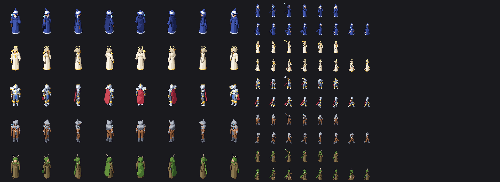

# PixelDSL Studio

[](https://github.com/revomarkone-max/PIXELDSLSTUDIO/actions/workflows/tests.yml)
[](./LICENSE)
[](https://creativecommons.org/publicdomain/zero/1.0/)

Deterministic, offline pixel-art generator for small game assets (8×8 – 128×128):
procedural items, creatures, VFX, **seamless terrain tiles**, a modular
**paper-doll** character system with 4-direction walk sheets, normal maps, and
Godot 4 / Unity export. No AI models, no network, no pip dependencies.

Two front-ends share the same specs:

- **Web Studio** — open `index.html` in a browser (Three.js is vendored).
- **CLI** — `pixeldsl.py` and `paperdoll.py`, pure Python 3.9+ standard library.


## What works well today

| Area | Status |
| --- | --- |
| Seamless tiles: grass, dirt, sand, stone, water (8-frame loop) | ✅ tested for seams, bit-identical in Py and JS |
| Items & simple props: swords, staffs, bows, potions, gems, flowers | ✅ readable at 32 px |
| Paper doll: humanoid + loadouts, 4-way walk, Godot `.tres`, Unity atlas | ✅ `paladin` and `wanderer` read well; other loadouts still need art passes |
| Creatures from SDF primitives (dragon, snake, golem…) | ⚠️ often not recognisable — use as a base, not final art |
| 3D rigs rendered to 32 px | ⚠️ experimental |

## Quick start

```bash
# Seamless tiles (any size; seed changes the layout)
python pixeldsl.py --generate stone --seed 88 --size 32x32
python pixeldsl.py --generate water --seed 99 --size 48x48     # animated

# Procedural sprites
python pixeldsl.py --generate sword --seed 42 --size 32x32
python pixeldsl.py --generate slime --seed 777 --size 32x32

# Paper doll: 4-direction walk sheet + normal map + engine metadata
python paperdoll.py --mannequin humanoid --loadout paladin --action walk --4way \
    --normal --export-godot --export-unity -o game_ready/paladin_walk_4way.png
python paperdoll.py --list-loadouts

# Compile any PixelDSL JSON spec / mutate one
python pixeldsl.py sprites/white_pink_bunny_jump_32x32.json
python pixeldsl.py --mutate sprites/white_pink_bunny_jump_32x32.json --seed 55
```

Output goes to `game_ready/`: `name.png`, `name_normal.png`, `name_preview.png`
and, for animations, `name_sheet.png`.

## hero3d: shared human base for game heroes

`hero3d/` builds characters on **one shared human base** (skeleton + body made of SDF
primitives) and renders them as 2.5D pixel art: orthographic camera tilted like a
top-down MOBA, 8 directions, idle / walk / attack. Outfits ("skins") are lists of
extra primitives on the same joints, so every new hero inherits the proportions,
animations and all directions for free. Needs `numpy` (the rest of the repo does not).

```bash
python -m hero3d.gm_export                       # all skins -> game_ready/heroes/*_sheet.png
python -m hero3d.gm_export --project "C:/DEEEEV/GameMakerProj/Quality MOBA graybox" mage
```



- `hero3d/base.py` - joints, body, animations (edit here to change every hero).
- `hero3d/skins.py` - clothing builders (`shirt`, `robe`, `hood`, `cape`, `boots`...) and the five heroes.
- `hero3d/gm_export.py` - GameMaker sprites `spr_h_<hero>_<anim>`, frames `dir * n + f`, dir 0 = facing the camera.

## Quality gate

Every generator change should pass the tests and be eyeballed in the gallery:

```bash
python -m unittest discover tests -v   # seams, silhouettes, Py/JS parity
python tools/gallery.py                # -> gallery/index.html
```

The tests check that tiles have no seam (both visually and by exact noise
periodicity), that every archetype produces a sane silhouette at 16/32/48 px,
that 4-way sheets have no empty cells, that the Godot `.tres` is valid, and
that `tilegen.py`/`tilegen.js` and the paper-doll assembler give identical
results in Python and JavaScript. CI runs them on every push.

## Project layout

| File | Role |
| --- | --- |
| `pixeldsl.py` / `renderer.js` | Spec compiler & rasteriser (SDF layers, grids, rigs, shaders) |
| `tilegen.py` / `tilegen.js` | Seamless tile generator (same algorithm, bit-exact) |
| `paperdoll.py` / `paperdoll.js` | Mannequins, equipment, poses, 4-way sheets, exporters |
| `archetypes.js`, `archetypes/` | Parametric archetype registry used by the Web Studio forge |
| `three_renderer.js` | Three.js 3D rigs baked to pixels (experimental) |
| `index.html`, `app.js`, `style.css` | Web Studio UI |
| `tests/`, `tools/gallery.py` | Quality gate |

## Web Studio shortcuts

| Key | Action |
| --- | --- |
| `D` / `E` / `S` / `G` | Pencil / eraser / eyedropper / bucket |
| `Ctrl+Z` / `Alt+Y` | Undo / redo |

## AI agents

`SKILL.md` (and `.agents/skills/pixel-sprite-generator/SKILL.md`) describe the
JSON spec and CLI so coding agents can produce assets through the compiler
instead of guessing pixels.

## License

Code: [MIT](./LICENSE). Generated sprites and bundled presets: [CC0 1.0](https://creativecommons.org/publicdomain/zero/1.0/) — use them anywhere, no attribution required.
