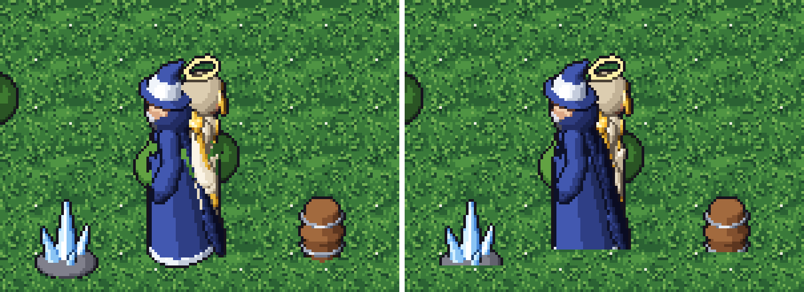

# Per-pixel depth sprites in Godot 4

PixelDSL ray-marches every sprite from a 3D model, so it knows each pixel's depth. `export --depth` writes it as a
second sheet (`*_d.png`: pixels behind the plane through the sprite origin, 16 bits in R/G, see
`pixeldsl.engine.depth_map`). This project draws sprites as camera-facing quads under an orthographic camera at the
sprite view's elevation; `depth_sprite.gdshader` moves each pixel back along the view ray by that depth and writes
`DEPTH`. Sprites then intersect each other and the ground per pixel: no Y-sorting, and no feet or bases cut off
where a tilted quad meets the ground.



Run with Godot 4.6: `godot --path examples/godot_depth` (D or Enter toggles depth). Screenshots without the editor:
`godot --path examples/godot_depth -- --shot=<folder>`.

Rebuild the art:

```bash
python -m pixeldsl export models/characters/priest.json models/characters/mage.json models/props/barrel.json \
    models/props/tree.json models/props/crystal.json --views topdown --anims idle,walk --depth \
    --out examples/godot_depth/art
python -m pixeldsl tiles grass --size 32 --out examples/godot_depth/art
```

Notes:

* Import the sheets losslessly without mipmaps (the `.import` files here): VRAM compression or filtering corrupts the
  packed depth.
* One sprite pixel = one screen pixel when the camera's orthographic `size` equals viewport height / pixels per unit.
* Writing `DEPTH` disables early depth testing for these draws; the cost is one extra texture fetch per pixel.
